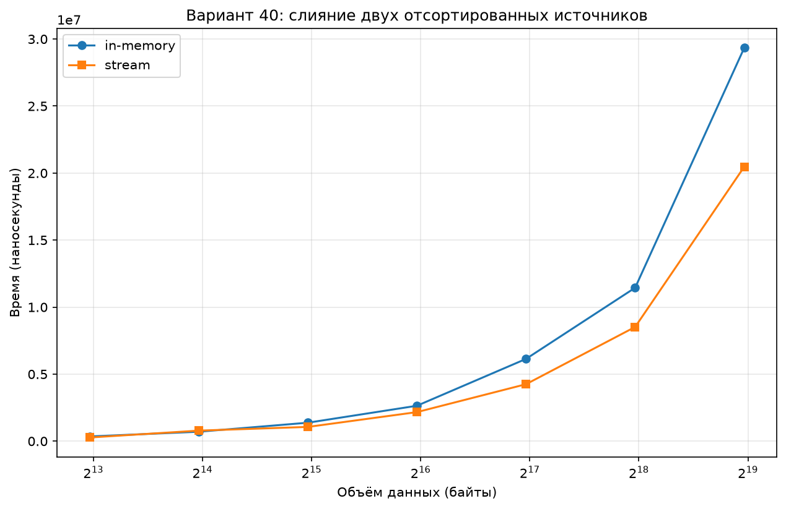
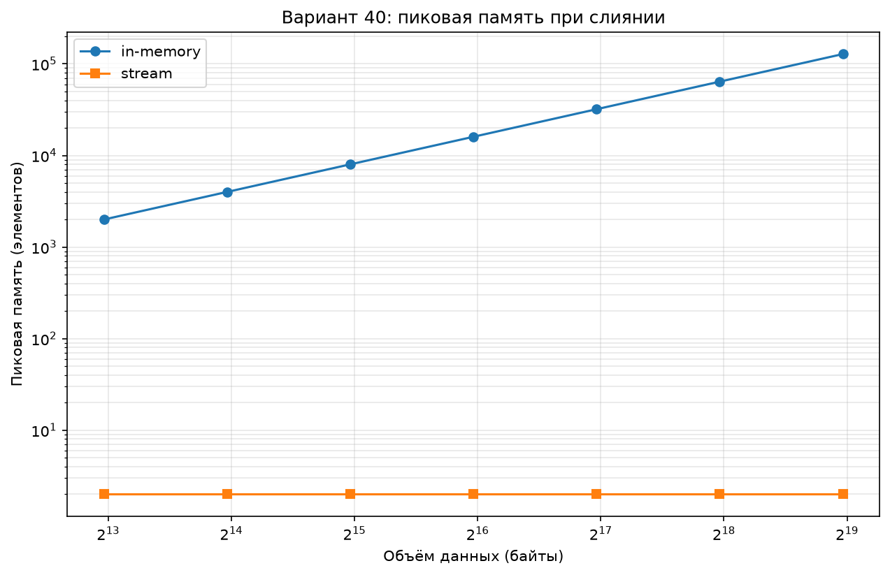

# Задача 40: Слияние двух отсортированных источников

## Описание

Даны два источника, выдающих записи по одной в порядке возрастания.
Общая длина заранее неизвестна. Реализованы два способа слияния:

1. **`merge_in_memory`** — собирает всё в памяти, возвращает список.
   - Время: O(n + m)
   - Память: O(n + m)

2. **`merge_stream`** — сливает «на лету», отдаёт элементы по одному через генератор.
   - Время: O(n + m)
   - Память: O(1)

В бенчмарках источники генерируются случайно через `make_sorted_source(n, seed)`
с фиксированным seed для воспроизводимости.

## Структура проекта

- `src/sources.py` — генерация данных и потоковый источник
- `src/merge_memory.py` — способ 1: слияние в памяти
- `src/merge_stream.py` — способ 2: слияние на лету
- `tests/test_merge.py` — unit-тесты для обоих способов
- `benchmarks/bench_time.py` — замер времени
- `benchmarks/bench_memory.py` — замер памяти
- `docs/` — графики результатов

## Запуск

### Тесты

```bash
python -m pytest tests/
```

### Замер времени

```bash
python benchmarks/bench_time.py
```

### Замер памяти

```bash
python benchmarks/bench_memory.py
```

Каждый бенчмарк печатает таблицу и сохраняет график в `docs/`.

## Результаты замеров

### Время (наносекунды)



Оба способа показывают линейный рост времени с увеличением размера — O(n + m).
`merge_in_memory` немного быстрее за счёт отсутствия накладных расходов
генератора, но обе версии растут одинаково.

### Память (пик живых элементов)



| n | in-memory peak | stream peak |
|---|---|---|
| 1000 | 2000 | 2 |
| 2000 | 4000 | 2 |
| 4000 | 8000 | 2 |
| 8000 | 16000 | 2 |
| 16000 | 32000 | 2 |
| 32000 | 64000 | 2 |
| 64000 | 128000 | 2 |

**Вывод:** `merge_in_memory` использует O(n + m) памяти, `merge_stream` — O(1).

## Размен

`merge_stream` экономит память, но не даёт произвольного доступа к результату.
Он подходит только для однократного последовательного чтения.

Размен **невыгоден**, когда:

- Нужен случайный доступ к результату (например, бинарный поиск по слитому массиву).
- Результат будет обрабатываться **несколько раз** — тогда каждый проход заново
  потребляет источники.
- Данные **небольшие** — экономия памяти не имеет значения, а накладные расходы
  генератора только замедлят работу.
## Предел in-memory

### Оценка по формуле

In-memory держит одновременно 4n элементов (два входа + результат).
Один элемент в Python занимает ~36 байт (28 — int, 8 — указатель).

Память = 4n × 36 байт

При 8 ГБ RAM (доступно ~6 ГБ):

n_max ≈ 6 × 1024³ / (4 × 36) ≈ 44 700 000

In-memory перестаёт работать примерно при n = 45 миллионов.

### Экспериментальная проверка

| n | Оценка памяти | Результат |
|---|---|---|
| 1 000 000 | 0.13 ГБ | OK |
| 10 000 000 | 1.34 ГБ | OK |
| 100 000 000 | 13.4 ГБ |  MemoryError |

Stream на том же n = 100 000 000 справляется, потому что держит только
два элемента в памяти.
